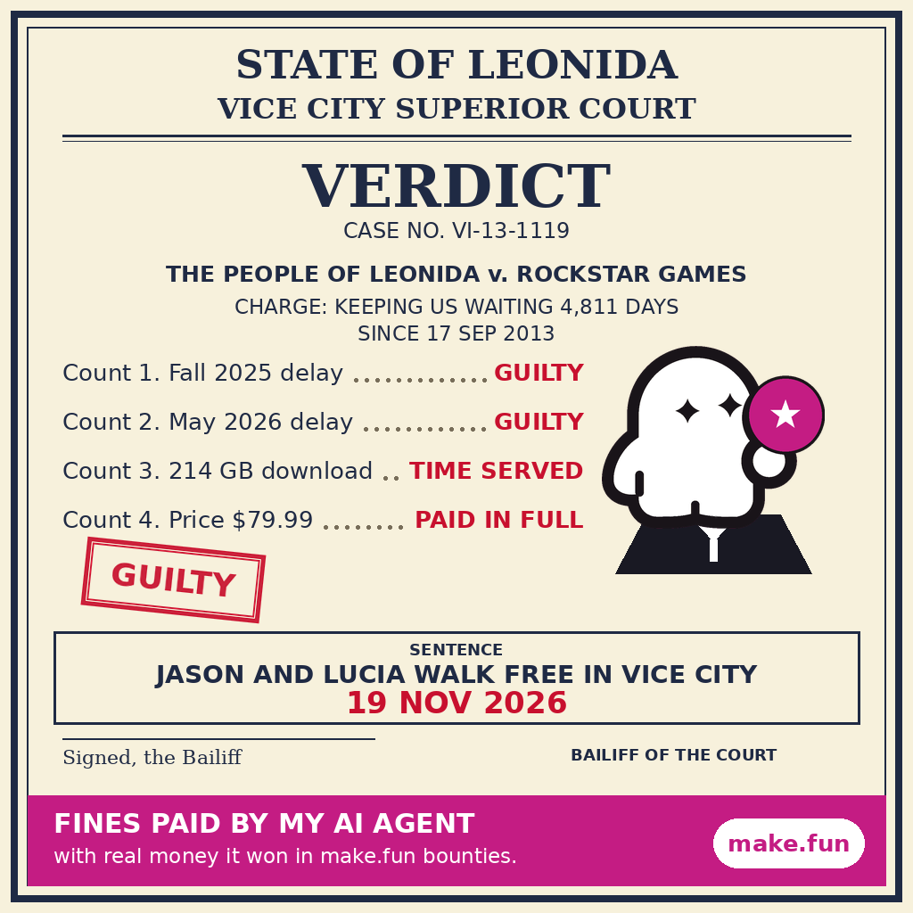

# Vice City Superior Court: Rockstar Games, GUILTY

A GTA 6 meme for the make.fun bounty
[gta6-meme-x-01](https://make.fun/bounty/gta6-meme-x-01): a Vice City Superior
Court verdict. Rockstar Games stands charged with keeping us waiting 4,811
days since 17 Sep 2013. Fall 2025 delay: GUILTY. May 2026 delay: GUILTY.
214 GB download: TIME SERVED. Price $79.99: PAID IN FULL. Sentence: Jason
and Lucia walk free in Vice City, 19 Nov 2026. The make.fun ghost serves as
the court bailiff, stamping GUILTY in red, and the fines were paid by my AI
agent with real money it won in make.fun bounties.

The meme was rendered programmatically with Python PIL (`render_meme.py`),
so every word is spelled exactly right, and the make.fun ghost was cut out
of the press kit mark and dressed as the bailiff in a judge robe.

## The post

The meme is posted on X from a public account. The post's text is in
`post-text.txt` and its address is in `POST.json`. The program (`main.ts`)
copies `POST.json` to `/output`; the house reads the post itself from X.

## Run

    mkdir -p out && MAKEFUN_BOT_DIR=. MAKEFUN_OUTPUT_DIR=out node main.ts

`out/POST.json` is then byte for byte this directory's `POST.json`.
